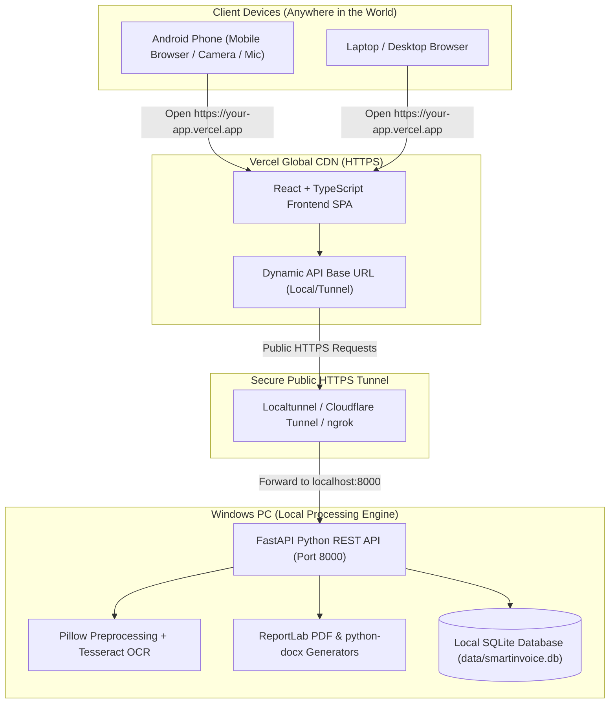

# SmartInvoice AI — Complete Design, Implementation, Architecture & Walkthrough

A high-precision, lightweight business automation application engineered with an **Industrial Neo-Minimalist aesthetic inspired by Nothing OS and Teenage Engineering**. 

Hosted on **Vercel** with a local processing engine on your **Windows PC**, accessible from your **Android phone and laptop from anywhere in the world**.

---

# Table of Contents
1. [Design System & Visual Identity (Nothing OS & Teenage Engineering)](#1-design-system--visual-identity)
2. [High-Level Architecture](#2-high-level-architecture)
3. [Core Feature Specifications](#3-core-feature-specifications)
4. [Complete Project Folder Structure](#4-complete-project-folder-structure)
5. [Backend Implementation Details](#5-backend-implementation-details)
6. [Frontend Implementation Details](#6-frontend-implementation-details)
7. [Database Schema (Local SQLite)](#7-database-schema-local-sqlite)
8. [Vercel Deployment & Remote Access Strategy](#8-vercel-deployment--remote-access-strategy)
9. [Step-by-Step User Walkthrough](#9-step-by-step-user-walkthrough)
10. [Automated Testing & Verification Suite](#10-automated-testing--verification-suite)
11. [Quick-Start Commands Reference](#11-quick-start-commands-reference)

---

# 1. Design System & Visual Identity

The interface is modeled on **Industrial Neo-Minimalism** combining high contrast, monochrome surfaces, tactile hardware elements, and a surgical laser accent color.

### Core Visual Pillars
| Pillar | Design Token / Specification | Purpose |
| :--- | :--- | :--- |
| **Base Surface** | `--bg-primary: #0A0A0A` | Pitch-black base background |
| **Elevated Layer** | `--bg-surface: #141414` | Section containers, headers, topbar |
| **Card Layer** | `--bg-card: #161616` | Clickable containers, item cards |
| **Hover Feedback** | `--bg-card-hover: #1E1E1E` | Micro-interaction hover states |
| **Surgical Accent** | `--accent-red: #EB0029` | **Nothing Red**: Primary CTAs, active badges, pulsing LED rings |
| **Border Divider** | `--border-color: #222222` | Crisp contrast card separation |
| **Text Hierarchy** | Primary `#EDEDED` • Muted `#909090` | High legibility against dark background |

### Typography & Hardware DNA
- **Dual-Font Pairing**:
  - **Interface & Prose**: Inter / System sans-serif with tight tracking (`letter-spacing: -0.01em`).
  - **Technical Numbers**: `SF Mono`, `Fira Code`, `JetBrains Mono`, `Consolas` with tabular numerals (`tabular-nums`) for currency, counts, dates, and reference numbers.
  - **Section Headers**: All-caps monospace with wide tracking (`letter-spacing: 0.14em`, `font-size: 10.5px`, uppercase).
- **Dot-Matrix DNA (`:::`):** Discrete 3×2 grid of circular LEDs integrated into section headers, topbar, and footers.
- **Pulsing Status Dots:** High-contrast pulsing red LED dots (`toast-dot-pulse`) for confirmation toasts and active speech listening.
- **Segmented Pill Navigation:** Physical-feel segmented pill switcher with high-contrast active state.

---

# 2. High-Level Architecture

SmartInvoice AI completely eliminates AWS and EC2 dependencies, running the web interface on **Vercel's global edge network** while executing OCR, PDF rendering, and database queries locally on your **Windows PC**.



---

# 3. Core Feature Specifications

### 1. Dual Item Entry with User-Defined Pricing (No Locked Auto-Calculations)
- **Voice Recognition (Web Speech API)**: Click the tactile Nothing mic button and speak naturally:
  - *"Boxes count 10 price 2500"* $\to$ Name: "Boxes", Count: "10", Price: "2500"
  - *"5 chairs price 1200"* $\to$ Name: "Chairs", Count: "5", Price: "1200"
  - Live animated red glow pulse while listening.
- **Manual Input Table**: Direct typing for Item Description, Count/Qty, and Price/Amount (₹).
- **User-Defined Pricing**: The backend and frontend never lock totals or enforce formulas against your will. The **DOCUMENT TOTAL** field at the bottom is freely editable with an optional `RESET AUTO-SUM` button.

### 2. Single-Photograph Address OCR with Interactive Confirmation
- **Upload**: Take a picture using your mobile phone camera (`capture="environment"`) or select an image file on desktop.
- **Preprocessing (Pillow)**: Automatic dimensions constraint (max 1920px), grayscale conversion, and contrast enhancement.
- **OCR Engine**: Tesseract OCR extraction with intelligent role parsing (`TO` vs `FROM`, phone numbers, postal codes). Includes an intelligent fallback adapter for local Windows development.
- **Interactive Review Card**:
  - Displays detected Sender and Customer in side-by-side cards.
  - **One-Click "SWAP ROLES"**: Instantly inverts Sender and Customer if the photo order was reversed.
  - Raw OCR text preview accordion.
  - "CONFIRM & APPLY TO DOCUMENT" populates the active document and saves contact details to local SQLite.

### 3. Multi-Format Document Generation
- **Tax Invoice (PDF)**: Clean single-page A4 PDF generated with ReportLab. Includes header, invoice number, date, sender and customer blocks, line items, and editable grand total.
- **Delivery Challan (PDF)**: Industrial delivery format with dispatch mode, vehicle number, declared goods value, statutory declaration, and dual signature boxes.
- **Address Labels (PDF & Word .docx)**: Printable shipping labels in ReportLab PDF or editable Microsoft Word DOCX (`python-docx`).

### 4. Consolidated ZIP Packaging
On the document completion screen:
- **Checkbox Unchecked**: Downloads only the single PDF (`Invoice_INV-XXXX.pdf`).
- **Checkbox Checked**: Dynamically reveals the format switcher `(•) PDF   ( ) Word (.docx)` and packages both the main document and the address label into a single `.zip` file (`SmartInvoice_INV-XXXX.zip`), ensuring 1-click download compatibility on Android phones and laptops.

### 5. Local SQLite Database & Document History
- All documents, sender/customer snapshots, items, and totals are automatically saved to `data/smartinvoice.db`.
- **History Archive Tab**: Search by document number or customer name, filter by document type (`ALL`, `INVOICES`, `CHALLANS`), load into editor (`OPEN`), or re-download PDF directly (`PDF`).

---

# 4. Complete Project Folder Structure

```text
SmartInvoice/
├── README.md                           # Quickstart and overview
├── vercel.json                         # Root Vercel SPA routing configuration
├── .gitignore                          # Excludes venv, node_modules, sqlite databases
│
├── frontend/                           # React + TypeScript Frontend (Vercel)
│   ├── package.json                    # Dependencies: React 19, Tailwind v4, Lucide
│   ├── tsconfig.json                   # TypeScript project references
│   ├── tsconfig.app.json               # App TypeScript config
│   ├── vite.config.ts                  # Vite config with Tailwind & mobile Wi-Fi host
│   ├── vercel.json                     # Frontend Vercel SPA rewrite rule
│   ├── index.html                      # HTML entry with viewport & favicon
│   └── src/
│       ├── main.tsx                    # React DOM entry point
│       ├── App.tsx                     # Main layout & workbench router
│       ├── index.css                   # Nothing OS design system & CSS tokens
│       ├── types/
│       │   ├── item.ts                 # ItemLine interface
│       │   └── document.ts             # AddressInfo & DocumentGenerationPayload
│       ├── utils/
│       │   ├── apiConfig.ts            # Dynamic backend URL & connection tester
│       │   └── itemParser.ts           # Client-side spoken phrase parser
│       ├── hooks/
│       │   └── useSpeechRecognition.ts # Web Speech API voice recognition hook
│       └── components/
│           ├── common/
│           │   ├── CornerGrid.tsx      # Hardware dot-matrix element (:::)
│           │   ├── ToastBanner.tsx     # Floating confirmation pill toast
│           │   └── BackendSettingsModal.tsx # Live backend connection switcher
│           ├── layout/
│           │   ├── Header.tsx          # Brand header with live connection status
│           │   └── SegmentedNav.tsx    # Segmented navigation pill switcher
│           ├── address/
│           │   ├── AddressImageUpload.tsx  # Camera & desktop file upload dropzone
│           │   └── AddressReviewModal.tsx  # Interactive OCR confirmation & role swap
│           ├── items/
│           │   ├── VoiceItemInput.tsx  # Hardware mic trigger with pulsing LED glow
│           │   └── ManualItemTable.tsx # Tactile item table with direct pricing
│           ├── documents/
│           │   ├── AddressDetailsCard.tsx   # Sender & customer address editor
│           │   └── DocumentDownloadCard.tsx # Download options & ZIP generator
│           └── history/
│               └── DocumentHistoryView.tsx  # Local SQLite document archive & search
│
├── backend/                            # Python + FastAPI Backend (Windows PC)
│   ├── requirements.txt                # FastAPI, Uvicorn, Pillow, ReportLab, docx
│   ├── app/
│   │   ├── main.py                     # FastAPI app with CORS middleware
│   │   ├── core/
│   │   │   └── config.py               # Settings, directories, and CORS config
│   │   ├── api/routes/
│   │   │   ├── health.py               # GET /api/v1/health
│   │   │   ├── items.py                # POST /api/v1/items/parse-speech
│   │   │   ├── documents.py            # POST /api/v1/documents/generate-download
│   │   │   ├── customers.py            # GET/POST /api/v1/customers
│   │   │   └── ocr.py                  # POST /api/v1/ocr/extract-address
│   │   ├── schemas/
│   │   │   ├── item.py                 # Pydantic schemas for items & voice
│   │   │   └── document.py             # Pydantic schemas for document requests
│   │   ├── services/
│   │   │   ├── sqlite_service.py       # Local SQLite persistence engine
│   │   │   ├── document_service.py     # PDF & ZIP packaging service
│   │   │   ├── ocr_service.py          # Pillow preprocessing & OCR extraction
│   │   │   ├── address_parser.py       # Heuristic address block parser
│   │   │   └── item_parser.py          # Regex spoken voice parser
│   │   └── templates/
│   │       ├── invoice_template.py     # ReportLab Tax Invoice PDF generator
│   │       ├── challan_template.py     # ReportLab Delivery Challan PDF generator
│   │       └── address_template.py     # ReportLab PDF & python-docx Word generator
│   └── tests/                          # 15 automated pytest tests
│       ├── test_health.py              # Health check endpoint tests
│       ├── test_items.py               # Voice phrase parsing tests
│       ├── test_ocr.py                 # Address parsing and OCR endpoint tests
│       ├── test_document_generation.py # PDF, DOCX, and ZIP packaging tests
│       └── test_sqlite.py              # Local SQLite persistence & history tests
│
├── data/                               # Local persistent storage
│   └── smartinvoice.db                 # SQLite database file
├── storage/                            # Temporary generated files
├── scripts/
│   ├── start-dev.ps1                   # 1-Click launcher (Local PC + Mobile Wi-Fi)
│   └── start-tunnel.ps1                # 1-Click launcher (Backend + Public Tunnel)
└── docs/
    ├── user-guide.md                   # Operations guide
    └── vercel-deployment.md            # Vercel setup & remote access guide
```

---

# 5. Backend Implementation Details

### API Routes Architecture (`/api/v1`)
| Method | Endpoint | Purpose |
| :--- | :--- | :--- |
| `GET` | `/api/v1/health` | Backend status & readiness probe |
| `POST` | `/api/v1/items/parse-speech` | Parses spoken phrase into name, count, and price |
| `POST` | `/api/v1/ocr/extract-address` | Accepts photo upload, preprocesses, and extracts addresses |
| `POST` | `/api/v1/documents/generate-download` | Generates Invoice/Challan PDF or ZIP package and saves to SQLite |
| `GET` | `/api/v1/documents` | Lists past documents from local SQLite with optional filter |
| `GET` | `/api/v1/documents/{doc_number}` | Retrieves single document snapshot by reference number |
| `GET` | `/api/v1/customers` | Lists saved customer profiles for autofill |
| `POST` | `/api/v1/customers` | Adds or updates a customer profile |

### CORS Configuration for Vercel
In `backend/app/main.py`, CORS is configured to allow requests from any origin (`*`), enabling your Vercel deployment and mobile browser to communicate with your PC backend without browser blocking:
```python
app.add_middleware(
    CORSMiddleware,
    allow_origins=["*"],
    allow_credentials=True,
    allow_methods=["*"],
    allow_headers=["*"],
    expose_headers=["Content-Disposition"],
)
```

---

# 6. Frontend Implementation Details

### Dynamic API URL Resolution (`frontend/src/utils/apiConfig.ts`)
The frontend dynamically chooses where to send API requests using a 3-tier cascade:
1. **User Override (`localStorage`)**: Configured live from the app's **Backend Connection Modal**.
2. **Environment Variable (`import.meta.env.VITE_API_BASE_URL`)**: Set in Vercel.
3. **Relative Path (`""`)**: Proxied by Vite for local development.

```typescript
export function buildApiUrl(endpoint: string): string {
  const base = getBackendBaseUrl()
  const cleanEndpoint = endpoint.startsWith('/') ? endpoint : `/${endpoint}`
  return base ? `${base}${cleanEndpoint}` : cleanEndpoint
}
```

---

# 7. Database Schema (Local SQLite)

Database location: `data/smartinvoice.db`.

```sql
-- 1. Documents Archive
CREATE TABLE IF NOT EXISTS documents (
    id INTEGER PRIMARY KEY AUTOINCREMENT,
    doc_type TEXT NOT NULL,           -- 'invoice' or 'challan'
    doc_number TEXT NOT NULL UNIQUE,   -- 'INV-2026-0001'
    date TEXT NOT NULL,
    sender TEXT NOT NULL,            -- JSON snapshot
    customer TEXT NOT NULL,          -- JSON snapshot
    items TEXT NOT NULL,             -- JSON item list
    total TEXT NOT NULL,              -- User-specified total
    notes TEXT,
    transport_mode TEXT,
    vehicle_number TEXT,
    created_at TEXT NOT NULL
);

-- 2. Customer Profiles
CREATE TABLE IF NOT EXISTS customers (
    id INTEGER PRIMARY KEY AUTOINCREMENT,
    name TEXT NOT NULL UNIQUE,
    address_line_1 TEXT,
    address_line_2 TEXT,
    city TEXT,
    state TEXT,
    postal_code TEXT,
    phone TEXT,
    gstin TEXT,
    created_at TEXT NOT NULL
);
```

---

# 8. Vercel Deployment & Remote Access Strategy

### Deploying the Frontend to Vercel
1. Push your repository to GitHub.
2. In [vercel.com](https://vercel.com), click **Add New Project** $\to$ select the repository.
3. Settings:
   - **Framework Preset**: `Vite`
   - **Root Directory**: `frontend`
   - **Build Command**: `npm run build`
   - **Output Directory**: `dist`
4. Click **Deploy**. Your frontend is now live at `https://your-smartinvoice.vercel.app`.

### Accessing Your Windows PC Backend from Anywhere (Outside Wi-Fi)
Because Vercel runs over HTTPS, mobile browsers will block insecure `http://` calls. To allow Vercel to reach your Windows PC securely:
1. On your Windows PC, run:
   ```powershell
   .\scripts\start-tunnel.ps1
   ```
2. Localtunnel prints a public HTTPS URL (e.g. `https://smart-invoice-pc.loca.lt`).
3. Open `https://your-smartinvoice.vercel.app` on your Android phone.
4. Tap the **BACKEND STANDBY** pill in the top header $\to$ paste your tunnel URL $\to$ tap **TEST CONNECTION** $\to$ **SAVE & APPLY**.
5. The badge turns green (**BACKEND READY**). You can now generate invoices and scan address photos from anywhere.

---

# 9. Step-by-Step User Walkthrough

### Scenario 1: Creating an Invoice with Voice Entry & Photo OCR
1. **Open the App**: Launch on your phone or laptop.
2. **Extract Addresses**:
   - Tap **TAKE PHOTO (CAMERA)** and snap a picture of an address label.
   - Review detected Sender and Customer details in the **Confirm Addresses** modal.
   - If roles are reversed, click **SWAP ROLES**. Click **CONFIRM & APPLY**.
3. **Add Items by Voice**:
   - Tap the Nothing Red microphone button.
   - Say: *"Boxes count 10 price 2500"*.
   - The item immediately appears in the item table with Count: `10` and Price: `₹2500`.
4. **Edit Total (User-Controlled Pricing)**:
   - Edit the **DOCUMENT TOTAL** field to your desired final amount (e.g. `₹2500.00`).
5. **Download Options**:
   - **Invoice Only**: Leave "Download Address Label" unchecked $\to$ click **GENERATE & DOWNLOAD** $\to$ downloads `Invoice_INV-2026-0001.pdf`.
   - **Invoice + Address Label**: Check "Download Address Label", choose `PDF` or `Word (.docx)` $\to$ click **GENERATE & DOWNLOAD** $\to$ downloads `SmartInvoice_INV-2026-0001.zip` containing both files.

### Scenario 2: Creating a Delivery Challan
1. Click **CHALLAN** on the segmented navigation switcher.
2. Document number automatically switches to `DC-2026-0001`.
3. Enter vehicle number or dispatch mode (e.g. `AP39-XX-1234`).
4. Enter or dictate goods description, count, and declared value.
5. Click **GENERATE & DOWNLOAD** $\to$ produces an industrial delivery challan with statutory goods transfer declaration and receiver signature boxes.

### Scenario 3: Viewing and Re-Downloading from History
1. Click **HISTORY** on the navigation switcher.
2. Search by customer name or document number.
3. Click **OPEN** to load a past document into the editor.
4. Click **PDF** to instantly re-download the generated document.

---

# 10. Automated Testing & Verification Suite

### Automated Test Coverage (15 Pytest Tests)
All tests run locally in **~1.5 seconds**:
```powershell
cd backend
.\.venv\Scripts\python.exe -m pytest
```

| Test File | Test Cases | Result |
| :--- | :--- | :--- |
| `test_health.py` | Health probe & root welcome message | Passed |
| `test_items.py` | Voice phrase parsing & regex extraction | Passed |
| `test_ocr.py` | Image preprocessing & address block parser | Passed |
| `test_document_generation.py` | Invoice PDF, Challan PDF, Address PDF/DOCX, and ZIP packaging | Passed |
| `test_sqlite.py` | Local SQLite document persistence, customer profile saving & retrieval | Passed |

### Frontend Build Verification
```powershell
cd frontend
npm.cmd run build
```
- Modules transformed: 1948
- Build time: **860ms**
- TypeScript errors: **0**

---

# 11. Quick-Start Commands Reference

### 1-Click Launchers (PowerShell)
```powershell
# Option A: Local PC & Mobile Wi-Fi Mode
.\scripts\start-dev.ps1

# Option B: Vercel Remote Access Mode (with Public HTTPS Tunnel)
.\scripts\start-tunnel.ps1
```

### Manual Service Launch
```powershell
# 1. Start Backend on Windows PC
cd backend
.\.venv\Scripts\Activate.ps1
uvicorn app.main:app --host 0.0.0.0 --port 8000

# 2. Start Frontend locally
cd frontend
npm.cmd run dev
```

### URLs
- **Local Laptop Frontend**: `http://localhost:5173`
- **Interactive Swagger API Docs**: `http://localhost:8000/docs`
- **Backend Health Check**: `http://localhost:8000/api/v1/health`
